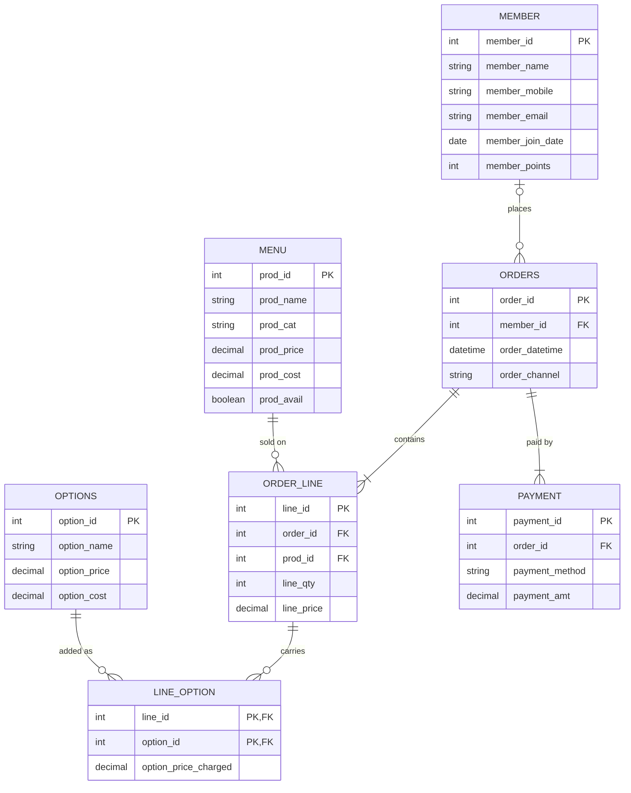

# Part A · The README

## 1. The Scenario

Chosen scenario: C Babson Bean Café.

## 2. The ERD

## 3. What One Row means

rows in each tables
1. member = one member person 
2. menu = one product (eg. espresso )
3. option = one additional option (eg.maple syrup)
4. order = one time of a customer placing an order (one customer can have many orders in a day and many lines on each order)
5. order_line = a unique item in an order (what product, what options, qty of product and options)
6.  payment = one payment attempt made by a customer

## 4. Design choices

4.1 Which key you chose where the business already had one, such as an email or a ticker, and why. 
- All keys both primary and foreign I choose to generate new ID column to prevent problem from data with similar names and also keep flexibility for change, as all the attributes could be changed later eg. customers might change name / number / email or the cafe might want to change their product name later. 

4.2 Which relationships are optional, and what in the scenario tells you so. 
- All relationships I made are mandatory. We can optionally add members to their menu history if you need deep data analytics but even that is unnecessary as they're already linked via order table. 

4.3 Which of the scenario's rules your tables cannot hold, and how you will check it instead. 
- A quantity is more than zero, and so is a payment. --> Force in query
- On the menu, a product's price is never below its cost.--> the table cannot guarantee that. need to make rules in query later 
- A payment's method is one of the four listed above. --> if really needed, could build one more table called "Payment method". I just think it's an overkill. Can force input by choice via code rule instead. 

4.4 One thing your agent proposed for the design that you changed or did not take, and why;  if you designed it alone, one thing you checked in the ERD your agent drew.
- I worked alone and just tell it to put in mermaid. Agent suggested table name "order_line" instead of just "line" which i think is good for clarity. 
- I checked the attributes, it miss order date and time I told it to include so I had to tell it to add that in